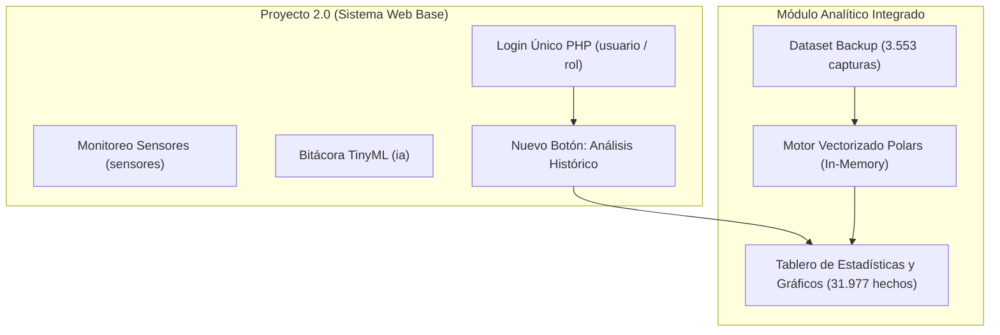

# Análisis Técnico de Compatibilidad e Integración: Fase 1 y Fase 2
## Proyecto de Grado: Sistema de Monitoreo Ambiental en Invernadero — COTECNOVA
**Autores:** Ana Sofía Castillo Moya & Víctor Hugo Hernández Peláez  
**Semillero:** STEM / COTECTRONIX  
**Fecha de revisión:** Octubre 2026  

---

## 1. Propósito de este Documento

Este documento tiene como objetivo explicar de forma clara, técnica y concisa la relación entre los dos repositorios del proyecto:
1. **`proyecto_grado_2.0`** (Base del sistema actual: Web PHP + ESP32 IoT + Bitácora TinyML).
2. **`proyecto_grado_cotectronix`** (Módulo de analítica avanzada: Modelo OLAP + 31.977 datos históricos + Tablero de Estadísticas).

El fin es definir cómo integrar el análisis de los **35.000 datos históricos** dentro de nuestro aplicativo principal sin generar choques de bases de datos ni duplicar sistemas de inicio de sesión.

---

## 2. Comparativa de Bases de Datos: ¿Por qué son distintas?

Ambas bases de datos no compiten entre sí; tienen naturalezas y propósitos arquitectónicos distintos:

```
┌──────────────────────────────────────────────┐       ┌──────────────────────────────────────────────┐
│       PROYECTO 2.0 (Transaccional - OLTP)    │       │     COTECTRONIX (Analítico - OLAP)           │
├──────────────────────────────────────────────┤       ├──────────────────────────────────────────────┤
│ • Motor: MySQL (Base_Datos_Proyecto)         │       │ • Motor: MySQL / In-Memory (Polars)          │
│ • Tablas: usuario, rol, sensores, ia         │       │ • Tablas: dim_tiempo, dim_sensor,            │
│ • Estructura horizontal (1 fila = 1 sensado  │       │   dim_surco_suelo,                           │
│   con los 9 valores en columnas).            │       │   fact_mediciones_invernadero                │
│ • Propósito: Operación en tiempo real.       │       │ • Estructura vertical (Kimball Star Schema): │
│   El ESP32 inserta cada hora y el usuario    │       │   9 filas atómicas por cada sensado.         │
│   inicia sesión en la plataforma PHP.        │       │ • Propósito: Gráficos, métricas y analítica. │
└──────────────────────────────────────────────┘       └──────────────────────────────────────────────┘
```

### El origen real de los datos en `cotectronix`
La base de datos analítica de `proyecto_grado_cotectronix` **no inventó información nueva ni proviene de sensores ajenos**. Su origen es el archivo de respaldo exportado de nuestro servidor:
* 📄 **`backup_servidor/datos_sensores_2024-04-16_a_2026-04-16.-v2csv.csv`**

El script ETL (`generar_bd_olap.py` / `etl_polars.py`) tomó las **3.553 filas históricas** de nuestra tabla `sensores` y multiplicó cada captura por sus 9 sensores físicos:
$$\text{Total Hechos Analíticos} = 3.553 \text{ capturas} \times 9 \text{ sensores} = \mathbf{31.977 \text{ registros atómicos}}$$

Esto permitió calcular para cada punto en el tiempo:
* **`flag_anomalia`:** Indica con `1` o `0` si la temperatura, humedad o lux se salieron de los límites agronómicos de confort.
* **`flag_riego`:** Indica con `1` o `0` si el surco evaluado (50%, 75% o 100%) estuvo por debajo de su humedad meta y requería activación de agua.

---

## 3. Identificación del Problema de Compatibilidad

En el proyecto `proyecto_grado_cotectronix` se desarrolló de forma paralela un esquema de seguridad independiente:
* Crearon tablas denominadas `seguridad_usuarios` y `seguridad_roles`.
* Crearon un archivo de base de datos local en SQLite (`seguridad_usuarios.db`).
* Diseñaron una pantalla de login propia dentro de Python / Streamlit.

### ¿Por qué NO debemos importar esa parte?
1. **Conflicto de Autenticación:** Nuestro sistema web en PHP (`stem`) ya cuenta con una tabla de usuarios (`usuario`), roles institucionales (`rol`), contraseñas encriptadas y sesiones probadas.
2. **Redundancia:** Obligaría al usuario a iniciar sesión dos veces: una en el sistema web principal y otra para ver los gráficos.
3. **Riesgo en MySQL:** Intentar mezclar las tablas de usuarios de ambos proyectos en la misma base de datos generaría inconsistencias en llaves foráneas y roles.

---

## 4. Solución Propuesta para la Integración

Para lograr una integración limpia, modular y segura:



### Reglas de la integración:
1. **`Base_Datos_Proyecto` se mantiene 100% intacta:**
   * Las tablas `usuario`, `rol`, `sensores` y la nueva tabla `ia` (Bitácora TinyML con electroválvulas del 0 al 7) continúan funcionando sin ninguna alteración.
2. **Desechar la seguridad duplicada de `cotectronix`:**
   * Se elimina la pantalla de login de Streamlit y las tablas `seguridad_*`. El control de acceso lo mantiene la plataforma web PHP.
3. **Carga Ultrarrápida en Memoria (In-Memory):**
   * El cargador de datos (`data_loader.py`) utiliza la función `cargar_modelo_olap_in_memory()`. Esta función lee directamente el CSV del backup y procesa las 31.977 métricas mediante **Polars** en memoria RAM en menos de **100 ms**, sin depender de configuraciones complejas de base de datos.
4. **Acceso directo mediante Botón en la Barra de Navegación:**
   * En el menú lateral (`Plantilla-Head-Heater-Aside-Admin.php`) agregamos el botón:
     ```html
     <button class="btn" onclick="location.href='I_Analisis_Historico.php'">Análisis Histórico</button>
     ```

---

## 5. Alternativas Técnicas para Mostrar el Análisis

Podemos visualizar los datos de dos formas:

### Opción A: Vista Nativa en PHP con Plotly.js / Chart.js (Recomendada)
* **Cómo funciona:** Se crea la página `I_Analisis_Historico.php` dentro de la carpeta `stem/`. 
* **Ventajas:**
  * Respeta exactamente el diseño visual institucional (Header verde, Sidebar, tipografía).
  * No requiere que el usuario instale ni ejecute Python o Streamlit en segundo plano; el servidor PHP se encarga de todo.
  * Carga instantánea en el navegador en `http://localhost:8085/I_Analisis_Historico.php`.

### Opción B: Integración con el Tablero Streamlit
* **Cómo funciona:** Se elimina el bloque de login (`render_login_view`) en el script `app.py` de `cotectronix`.
* **Ventajas:**
  * Reutiliza al 100% los componentes de Streamlit y Plotly ya desarrollados en la carpeta `pag/`.
* **Desventaja:**
  * Requiere tener corriendo dos procesos en el computador: el servidor PHP (puerto 8085) y Streamlit (puerto 8501).

---

## 6. Resumen Ejecutivo para la Sustentación de Grado

| Aspecto | Estado / Definición |
|---|---|
| **Base de Datos Operativa (Fase 1 + TinyML)** | `Base_Datos_Proyecto` (MySQL) → Administra usuarios, sensores en tiempo real y la bitácora de electroválvulas de la IA. |
| **Base de Datos Analítica (Fase 2 / OLAP)** | Esquema en Estrella de Ralph Kimball → Analiza 3.553 capturas y 31.977 hechos atómicos históricos. |
| **Punto de Unión** | El botón **"Análisis Histórico"** en el aplicativo web conecta la experiencia del usuario sin pedir autenticación adicional. |
| **Garantía Técnica** | No hay riesgo de pérdida de datos ni sobreescritura de tablas existentes. |
